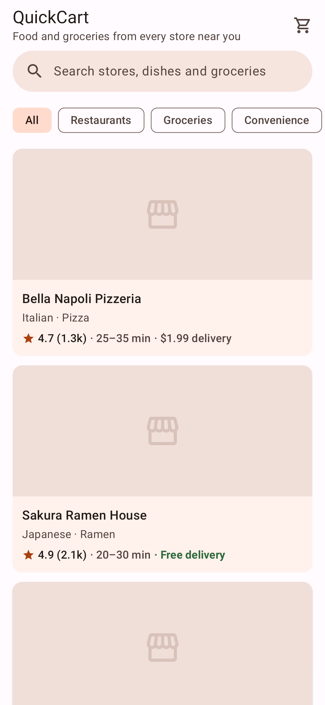
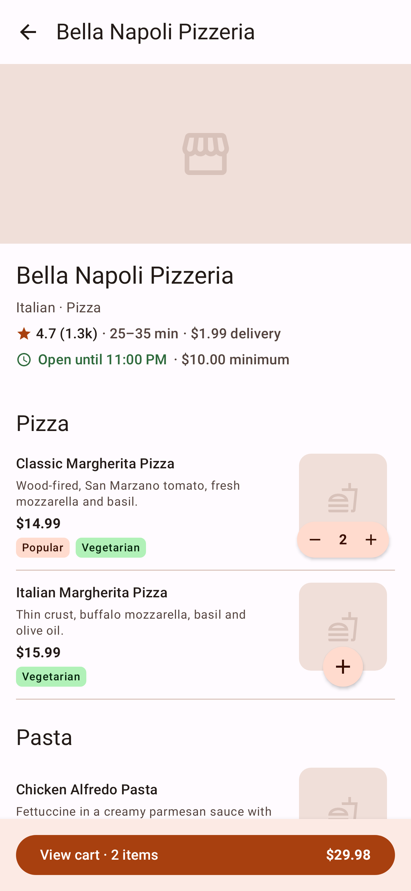
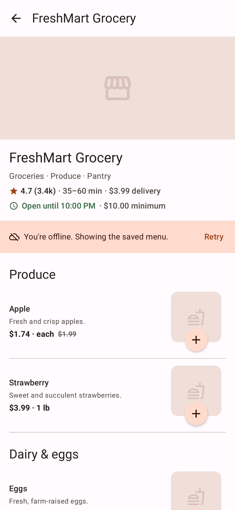
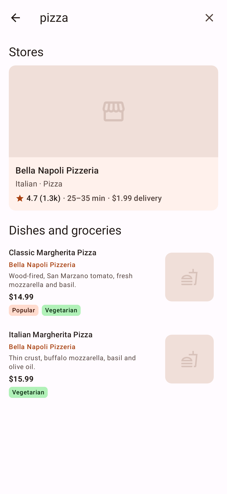
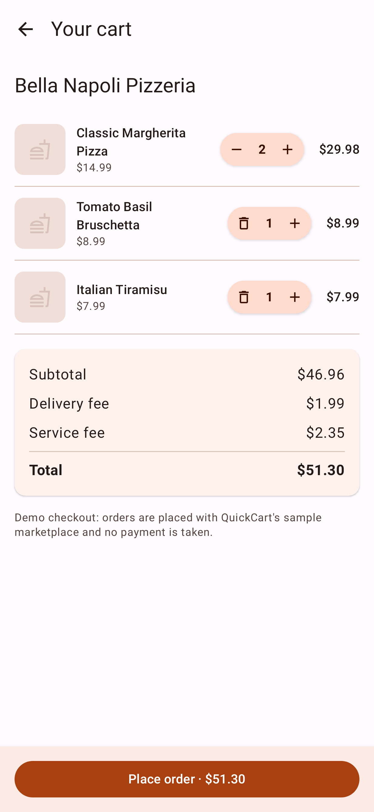
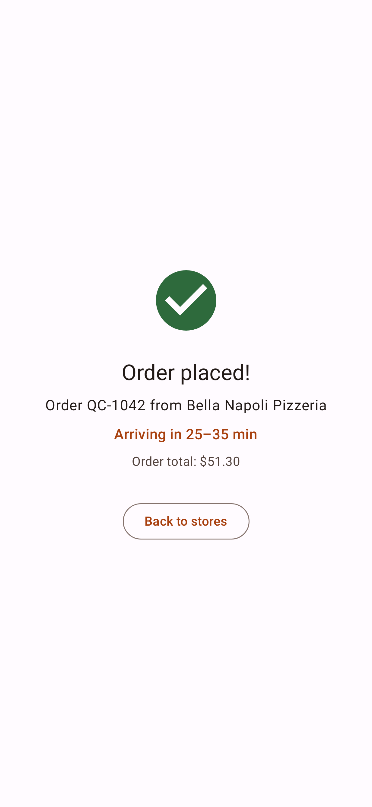
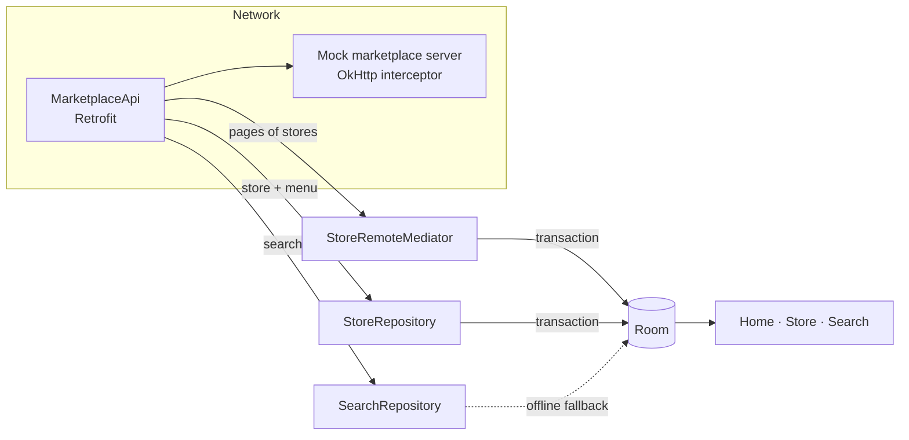

# QuickCart

[](https://github.com/Sravanthipanga/quickcart-android/actions/workflows/ci.yml)

**Food and groceries from every store near you.**

QuickCart is an offline-first Android marketplace for food delivery and groceries, built with Kotlin and Jetpack Compose. Browse restaurants, grocery and convenience stores, dessert shops and smoothie bars in one app, open any store's menu or aisles, and search dishes and groceries across all of them.

<p align="center">
  
  
  
  
</p>
<p align="center">
  
  
</p>

<sub>Screenshots are rendered from code without network access, so photos show as placeholders. The app loads real food photos.</sub>

## Features

- **Every kind of store:** 11 stores across restaurants (Italian, Pakistani and Indian, Japanese, Mexican, Pan-Asian, Mediterranean, Hawaiian), a grocery store, a 24/7 convenience store, a dessert shop and a smoothie bar.
- **Filter by store type:** All, Restaurants, Groceries, Convenience, Desserts, Drinks.
- **Store pages:** cover photo, rating, delivery time and fee, minimum order, and live open/closed status, including stores that close after midnight or are open 24/7.
- **Menus and aisles:** dishes by section with Popular, Vegetarian and Spicy tags; groceries with units ("per lb", "dozen") and sale prices.
- **Search everything:** stores by name or cuisine, and dishes and groceries across all stores, each labelled with its store.
- **Cart and checkout:** add dishes or groceries with quantity steppers; the cart is saved on the phone. One store per order, with a "Start a new cart?" prompt when switching stores. Checkout shows subtotal, delivery and service fees, enforces the store's minimum order and opening hours, and confirms with an order number and arrival time.
- **Works offline:** browsed stores, menus and search keep working without a connection, with a clear "you're offline" notice and Retry.

## How it works



- **Room is the single source of truth.** Screens read the database; the network only writes to it. The last loaded stores and menus work offline.
- **Paging 3 RemoteMediator** loads stores page by page. Stores and the "next page" key are written in one transaction. Type filters run in the Room query, so a filtered list keeps paging correctly.
- **Menus refresh in the background:** a store page shows its cached menu instantly and updates when the network answers. A menu is replaced in one transaction, so removed dishes disappear and it's never half-updated.
- **Search** is debounced (300 ms), skips repeated and too-short queries, and cancels stale requests so results never arrive out of order. Offline, it searches cached stores and menus.
- **Mock marketplace server.** The app makes real HTTP calls through Retrofit and OkHttp; an interceptor answers them from bundled data with realistic latency. Everything above it (paging, caching, offline handling) runs exactly as it would against a real backend. Switching to one means changing the base URL and a build flag in `:core:network`.
- **Money is exact:** prices are whole cents end to end, never floating point.

### How checkout works

1. The cart lives in Room, so it survives closing the app. Each line keeps a snapshot of the item so the cart shows even without the menu cached.
2. The checkout preview prices the cart with `priceOrder`: subtotal, the store's delivery fee, and a 5% service fee (min $0.99, max $4.99).
3. **Place order** sends only item ids and quantities. The server re-prices everything from its own data, checks the minimum order and opening hours, and returns the official totals. It uses the same `priceOrder` function, so the preview always matches. A stale or tampered cart can never decide the price.
4. The cart is cleared **only after** the server accepts the order. If the order is rejected (closed, below minimum, item unavailable) or the phone is offline, the cart is kept and the reason is shown.

## Tech stack

Kotlin · Jetpack Compose (Material 3) · Coroutines & Flow · Hilt · Room · Paging 3 (RemoteMediator) · Retrofit + OkHttp · kotlinx.serialization · Coil · Navigation Compose · JUnit, Turbine, Robolectric · Roborazzi screenshots · GitHub Actions

## Architecture

| Module | Responsibility |
|---|---|
| `:app` | Application, activity, navigation, Hilt entry point |
| `:feature:home` | Store list with search entry, type filters, paging, loading, error and offline states |
| `:feature:store` | Store header, open/closed status and the menu or aisles by section |
| `:feature:cart` | Cart, price breakdown, minimum-order and opening-hours checks, place order, confirmation |
| `:feature:search` | Debounced search across stores, dishes and groceries |
| `:core:ui` | Shared composables: store card, menu item row, remote image |
| `:core:data` | Repositories and the paging `RemoteMediator`, with offline fallbacks |
| `:core:network` | Retrofit API, DTOs, and the mock marketplace server with its bundled data |
| `:core:database` | Room tables for stores, menu items, paging keys and the cart, with a tested migration |
| `:core:model` | Pure Kotlin models: stores, opening hours, menu items, cart, order pricing, money |
| `:core:designsystem` | QuickCart Material 3 theme |
| `:core:testing` | Test rules, fakes and sample data |
| `build-logic` | Gradle convention plugins shared by every module |

## Testing

78 tests run on every pull request:

- **Integration tests against the real bundled marketplace.** The repositories and paging run through the actual Retrofit client and mock server, with a real in-memory Room database and an "airplane mode" switch to test offline behaviour.
- **Checkout against the mock server:** server-side pricing, minimum order, closed stores, unknown items, and the cart surviving rejection and offline failures.
- **Database migration test** that upgrades a real v1 database to v2 and checks the data survives.
- **Data checks.** The bundled data is validated: unique IDs, every item belongs to a store, valid prices, hours and images.
- **ViewModel tests.** These include a virtual-time test proving that fast typing triggers only one search.
- **Screenshot tests.** They double as rendering checks.

## Build and run

Requires JDK 17 and the Android SDK (compiles against API 36, targets API 35).

```bash
./gradlew assembleDebug        # build the app
./gradlew testDebugUnitTest    # run unit tests
./gradlew lintDebug            # run Android lint
./gradlew recordRoborazziDebug # regenerate screenshots in docs/screenshots
```

Dish names and photos and grocery products come from the public [DummyJSON](https://dummyjson.com) recipes and groceries data; store details and restaurant prices are sample data.

## Roadmap

- [x] Offline-first paging foundation and CI
- [x] Food and grocery marketplace: stores, menus, aisles, search
- [x] Cart and checkout (minimum order, delivery and service fees, one store per order)
- [ ] Order history and live order tracking
- [ ] Deep links and notifications
- [ ] Performance: baseline profile and startup benchmarks
- [ ] Play Store release

## License

[MIT](LICENSE)
