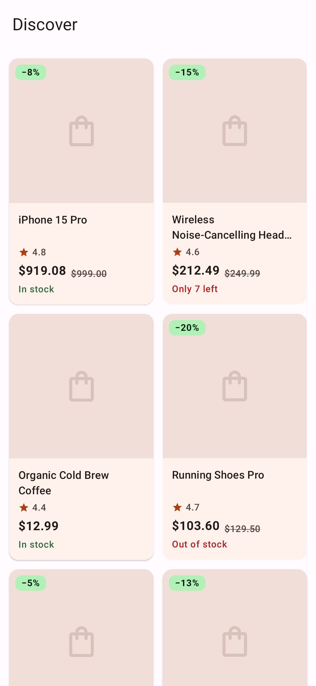
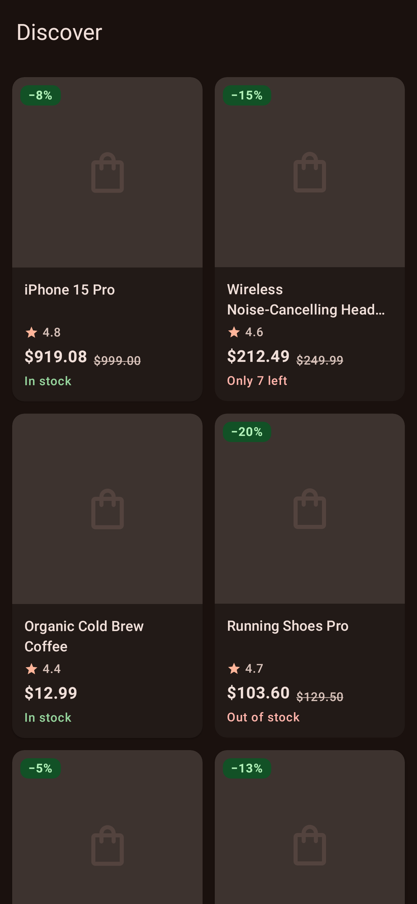
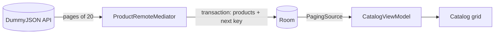

# QuickCart

[](https://github.com/Sravanthipanga/quickcart-android/actions/workflows/ci.yml)

**Shopping that keeps up with you.**

QuickCart is an offline-first Android shopping app built with Kotlin and Jetpack Compose: browse and search a product catalog, manage a cart, check out and track orders.

<p align="center">
  
  
</p>

<sub>Screenshots are rendered from code without network access, so product photos show as placeholders. The app loads real photos.</sub>

## Roadmap

- [x] Catalog: multi-module skeleton, paged product list with offline cache, CI
- [ ] Search with debounce, categories and product details
- [ ] Cart and checkout
- [ ] Order history and live order tracking
- [ ] Deep links and notifications
- [ ] Performance: baseline profile and startup benchmarks
- [ ] Screenshots and Play Store release

## How the offline catalog works



- **Room is the single source of truth.** The UI only reads the database, and the network only writes to it, so the last loaded catalog works offline.
- **Paging 3 RemoteMediator** fetches the next page as you scroll. Products and the "next page" key are written in one transaction, so they can never disagree.
- **Smart startup.** A cache under an hour old is shown immediately without a network call; older caches refresh.
- **Graceful failure.** If a refresh fails while products are cached, they stay on screen with a "You're offline" message and Retry.
- **Money is exact.** Prices are converted to whole cents once, at the network boundary, and never handled as floating point.

## Tech stack

Kotlin · Jetpack Compose (Material 3) · Coroutines & Flow · Hilt · Room · Paging 3 (RemoteMediator) · Retrofit + OkHttp · kotlinx.serialization · Coil · Navigation Compose · JUnit, Turbine, MockWebServer, Robolectric · Roborazzi screenshots · GitHub Actions

## Architecture

| Module | Responsibility |
|---|---|
| `:app` | Application, activity, navigation host, Hilt entry point |
| `:feature:catalog` | Product grid, loading, error, retry and offline states |
| `:core:data` | Repositories and the paging `RemoteMediator` |
| `:core:network` | Retrofit API, DTOs and the conversion to app models |
| `:core:database` | Room database for products and paging keys |
| `:core:model` | Pure Kotlin models (`Product`, prices in cents) |
| `:core:designsystem` | QuickCart Material 3 theme |
| `:core:testing` | Test rules, fakes and sample data |
| `build-logic` | Gradle convention plugins shared by every module |

## Build and run

Requires JDK 17 and the Android SDK (compiles against API 36, targets API 35).

```bash
./gradlew assembleDebug        # build the app
./gradlew testDebugUnitTest    # run unit tests
./gradlew lintDebug            # run Android lint
./gradlew recordRoborazziDebug # regenerate screenshots in docs/screenshots
```

Product data comes from the public [DummyJSON](https://dummyjson.com) API.

## License

[MIT](LICENSE)
